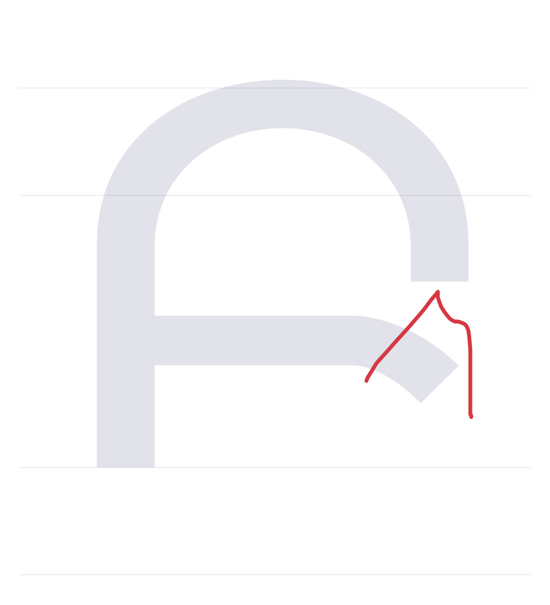

# Зарисовки

[Открыть галерею](https://pavljenko.github.io/nor-nakhijevan-review/gallery.html)

Новые варианты сверху. Все предыдущие версии сохранены в папке submissions.

### Գ · 2026-11-01 07:56 UTC

[SVG](submissions/93a09cc1-2cf1-49d1-853c-4845d388fa7f/U0533-f1448a4bf05cd870ecf7bc54ac3ce37b.svg) · [Данные](submissions/93a09cc1-2cf1-49d1-853c-4845d388fa7f/U0533-f1448a4bf05cd870ecf7bc54ac3ce37b.json)

### բ · 2026-11-01 07:55 UTC

[SVG](submissions/93a09cc1-2cf1-49d1-853c-4845d388fa7f/U0562-ba9291197244a956c76b8435be0b4dd2.svg) · [Данные](submissions/93a09cc1-2cf1-49d1-853c-4845d388fa7f/U0562-ba9291197244a956c76b8435be0b4dd2.json)

### Բ · 2026-11-01 07:55 UTC

[SVG](submissions/93a09cc1-2cf1-49d1-853c-4845d388fa7f/U0532-35b34e4e5000396c6c13e148003860c0.svg) · [Данные](submissions/93a09cc1-2cf1-49d1-853c-4845d388fa7f/U0532-35b34e4e5000396c6c13e148003860c0.json)

### բ · 2026-11-01 07:46 UTC

[SVG](submissions/65eb7f05-60bd-4f7e-a76d-c6f046790e57/U0562-8a5217657e1de58a29db6622528ad796.svg) · [Данные](submissions/65eb7f05-60bd-4f7e-a76d-c6f046790e57/U0562-8a5217657e1de58a29db6622528ad796.json)

### Բ · 2026-11-01 07:44 UTC

[SVG](submissions/65eb7f05-60bd-4f7e-a76d-c6f046790e57/U0532-33da1b2890e39d0a28a5d0de99bdd65d.svg) · [Данные](submissions/65eb7f05-60bd-4f7e-a76d-c6f046790e57/U0532-33da1b2890e39d0a28a5d0de99bdd65d.json)

### Ա · 2026-11-01 07:43 UTC

Техническая проверка мобильного редактора — не авторский вариант

[SVG](submissions/76fd8e3d-fd76-4c3c-9942-1a3ac30cc017/U0531-b1bd9e83fd00364f9add95a34a698277.svg) · [Данные](submissions/76fd8e3d-fd76-4c3c-9942-1a3ac30cc017/U0531-b1bd9e83fd00364f9add95a34a698277.json)

### Բ · 2026-11-01 07:41 UTC

[SVG](submissions/a07fc450-c652-4add-b76e-3e1460aeeb26/U0532-b8802db39b29e5fd3d08e87a2c4895cd.svg) · [Данные](submissions/a07fc450-c652-4add-b76e-3e1460aeeb26/U0532-b8802db39b29e5fd3d08e87a2c4895cd.json)

### Բ · 2026-11-01 07:39 UTC

[SVG](submissions/c7b6ccf1-473f-47f6-8443-ebf819a3e591/U0532-91a9f7a28e6d527ee87cce1dcc602874.svg) · [Данные](submissions/c7b6ccf1-473f-47f6-8443-ebf819a3e591/U0532-91a9f7a28e6d527ee87cce1dcc602874.json)

### բ · 2026-11-01 07:35 UTC

[SVG](submissions/115cf32f-3ebe-476b-bc89-f7a3ff1a6145/U0562-c8794eb041f2468fcff0ca601e24a71e.svg) · [Данные](submissions/115cf32f-3ebe-476b-bc89-f7a3ff1a6145/U0562-c8794eb041f2468fcff0ca601e24a71e.json)

### Բ · 2026-11-01 07:34 UTC

[SVG](submissions/115cf32f-3ebe-476b-bc89-f7a3ff1a6145/U0532-17ae425133686ffc74c8e30fb21ba2de.svg) · [Данные](submissions/115cf32f-3ebe-476b-bc89-f7a3ff1a6145/U0532-17ae425133686ffc74c8e30fb21ba2de.json)

### ա · 2026-11-01 07:34 UTC

[SVG](submissions/115cf32f-3ebe-476b-bc89-f7a3ff1a6145/U0561-f048eb802faf5d0fdf20bfa8304508ea.svg) · [Данные](submissions/115cf32f-3ebe-476b-bc89-f7a3ff1a6145/U0561-f048eb802faf5d0fdf20bfa8304508ea.json)

### Ա · 2026-11-01 07:34 UTC

[SVG](submissions/115cf32f-3ebe-476b-bc89-f7a3ff1a6145/U0531-ad649cc51860d6a8fbcaef0681cb8dff.svg) · [Данные](submissions/115cf32f-3ebe-476b-bc89-f7a3ff1a6145/U0531-ad649cc51860d6a8fbcaef0681cb8dff.json)

### Ա · 2026-11-01 07:31 UTC

Техническая проверка сохранения — не авторский вариант

[SVG](submissions/1f37d54b-a826-4b99-b06a-af67f484c811/U0531-252be8f6e5235d3167718ecc1768700e.svg) · [Данные](submissions/1f37d54b-a826-4b99-b06a-af67f484c811/U0531-252be8f6e5235d3167718ecc1768700e.json)
