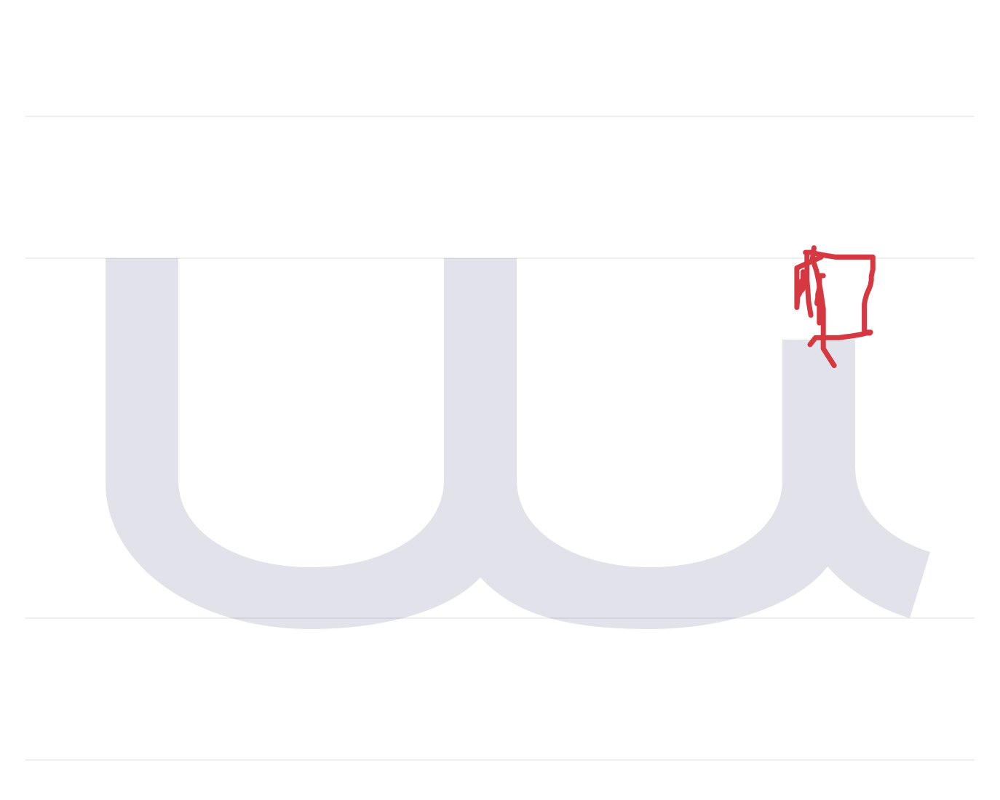

# Зарисовки Nor Nakhijevan

**[Открыть галерею →](https://pavljenko.github.io/nor-nakhijevan-review/gallery.html?v=live2)** · [Архив на GitHub](https://github.com/pavljenko/nor-nakhijevan-review/tree/drawings)

---

# Նոր Նախիջևան — Armenian glyph construction review

Mobile drawing stand for reviewing 38 Armenian uppercase/lowercase pairs of Nor Nakhijevan / Ростовтрам.

## Use

Open the shared Pages link, select a letter, and draw directly on the canvas. The canvas, tools and Save button fit on one screen. The grid icon opens the public gallery. Each page load starts a clean drawing session. Changes are automatically submitted; wait for the saved confirmation before closing the page. Saved SVG and JSON files remain public in the `drawings` branch, grouped by session.

The `main` branch contains the stand and collector source. GitHub Pages serves `docs/`. Drawing submissions go to `drawings`, so they do not rebuild Pages. The collector on the owner's server validates submissions, stores them durably, and pushes immutable SVG/JSON pairs. GitHub credentials are never sent to a visitor's browser. The shared link contains only the stand's submission capability.

## Files

- `docs/`: static website for GitHub Pages.
- `server.py`: Python standard-library collector and Git archive uploader.
- `glyphs.json`: approved reference contours used by the stand.
- `test_archive.py`: collector and uploader checks without GitHub credentials.
- `deployment/`: service and nginx configuration.

Font contours and submitted artwork are published for review. This repository does not grant a font distribution or reuse license.

## Build

Edit `src/review.html`, then run `python3 build.py`. The build embeds the approved reference paths in an immutable JavaScript asset and updates `docs/index.html`. No dependencies are required.

Saved constructions automatically update `gallery.json`, thumbnail aliases and the visual README in the `drawings` branch. The gallery groups revisions by session and glyph, with the newest saved variant first. Original SVG/JSON versions remain in the archive.

## Owner controls

The owner receives a separate private gallery link. It enables deletion only after server-side verification of a dedicated owner capability; the shared submission key cannot delete. Deleting a card removes every intermediate revision for that session and glyph from the current archive, gallery and preview aliases. Git history retains previous commits. Never publish the owner key in this repository or share the private management link.

The public gallery reads the live `/api/gallery` endpoint with no-store caching and refreshes every five seconds while visible, plus on focus. Deletion tombstones are excluded immediately, before GitHub cleanup completes.
