# Зарисовки

[Открыть галерею](https://pavljenko.github.io/nor-nakhijevan-review/gallery.html?v=live2)

Новые варианты сверху. Все предыдущие версии сохранены в папке submissions.

### Ֆ · 2026-11-01 08:16 UTC

Техническая проверка публичного удаления

[SVG](submissions/f99835c6-0e6d-4f80-9f16-dfbb1b249167/U0556-cc67275ef1fca2e9ef5f9163ae542999.svg) · [Данные](submissions/f99835c6-0e6d-4f80-9f16-dfbb1b249167/U0556-cc67275ef1fca2e9ef5f9163ae542999.json)

### ա · 2026-11-01 08:11 UTC

[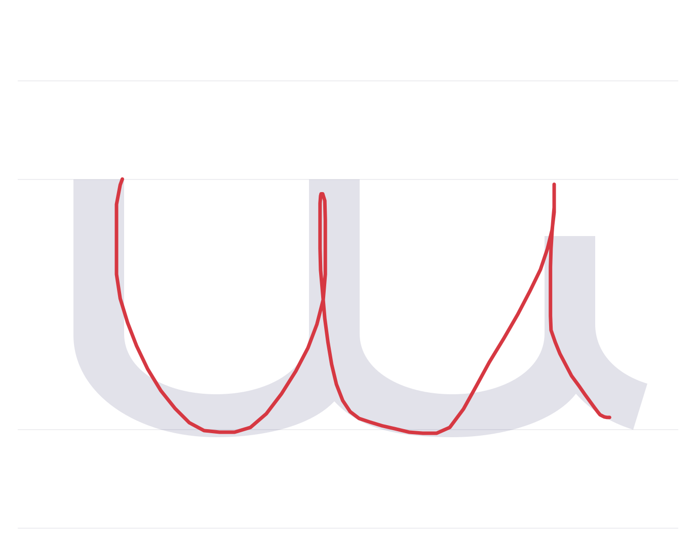](submissions/a6607980-ab33-4a89-ab89-0d46734ef704/U0561-e165a2b4fab9557853bd77ee57d6547b.svg)

[SVG](submissions/a6607980-ab33-4a89-ab89-0d46734ef704/U0561-e165a2b4fab9557853bd77ee57d6547b.svg) · [Данные](submissions/a6607980-ab33-4a89-ab89-0d46734ef704/U0561-e165a2b4fab9557853bd77ee57d6547b.json)

### Ա · 2026-11-01 08:11 UTC

[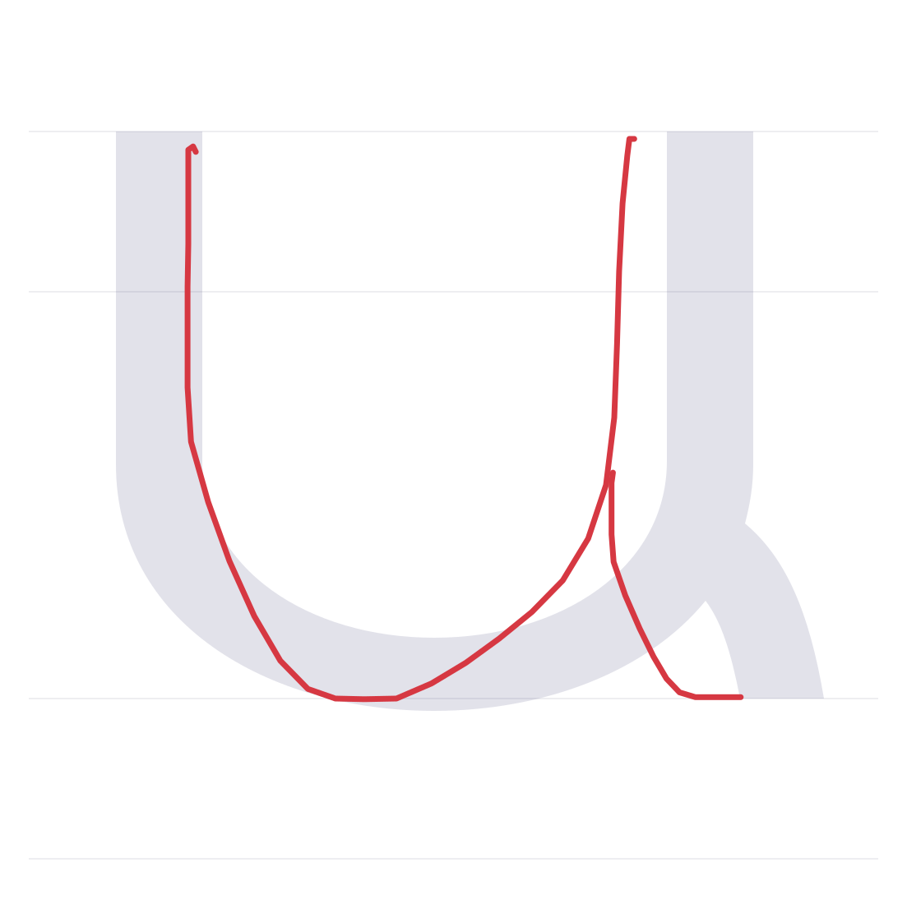](submissions/a6607980-ab33-4a89-ab89-0d46734ef704/U0531-b64e1b6174b32025b8cbfb7eff18d1a5.svg)

[SVG](submissions/a6607980-ab33-4a89-ab89-0d46734ef704/U0531-b64e1b6174b32025b8cbfb7eff18d1a5.svg) · [Данные](submissions/a6607980-ab33-4a89-ab89-0d46734ef704/U0531-b64e1b6174b32025b8cbfb7eff18d1a5.json)

### գ · 2026-11-01 07:56 UTC

[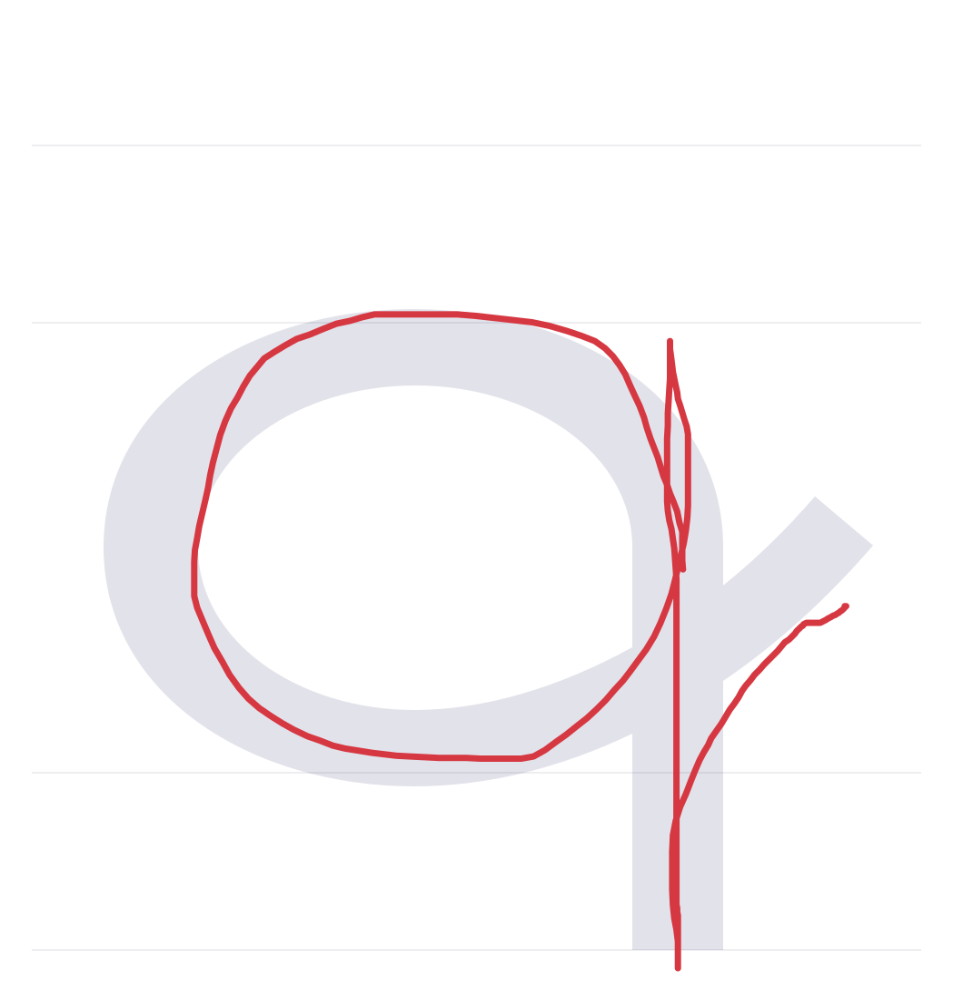](submissions/93a09cc1-2cf1-49d1-853c-4845d388fa7f/U0563-f581fe774f859ed27bdc23ca033b5492.svg)

[SVG](submissions/93a09cc1-2cf1-49d1-853c-4845d388fa7f/U0563-f581fe774f859ed27bdc23ca033b5492.svg) · [Данные](submissions/93a09cc1-2cf1-49d1-853c-4845d388fa7f/U0563-f581fe774f859ed27bdc23ca033b5492.json)

### Գ · 2026-11-01 07:56 UTC

[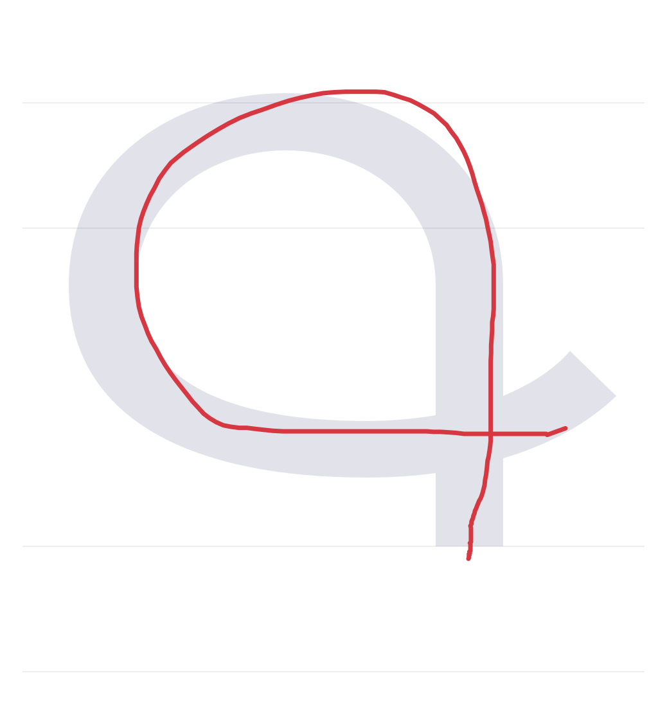](submissions/93a09cc1-2cf1-49d1-853c-4845d388fa7f/U0533-f1448a4bf05cd870ecf7bc54ac3ce37b.svg)

[SVG](submissions/93a09cc1-2cf1-49d1-853c-4845d388fa7f/U0533-f1448a4bf05cd870ecf7bc54ac3ce37b.svg) · [Данные](submissions/93a09cc1-2cf1-49d1-853c-4845d388fa7f/U0533-f1448a4bf05cd870ecf7bc54ac3ce37b.json)

### բ · 2026-11-01 07:55 UTC

[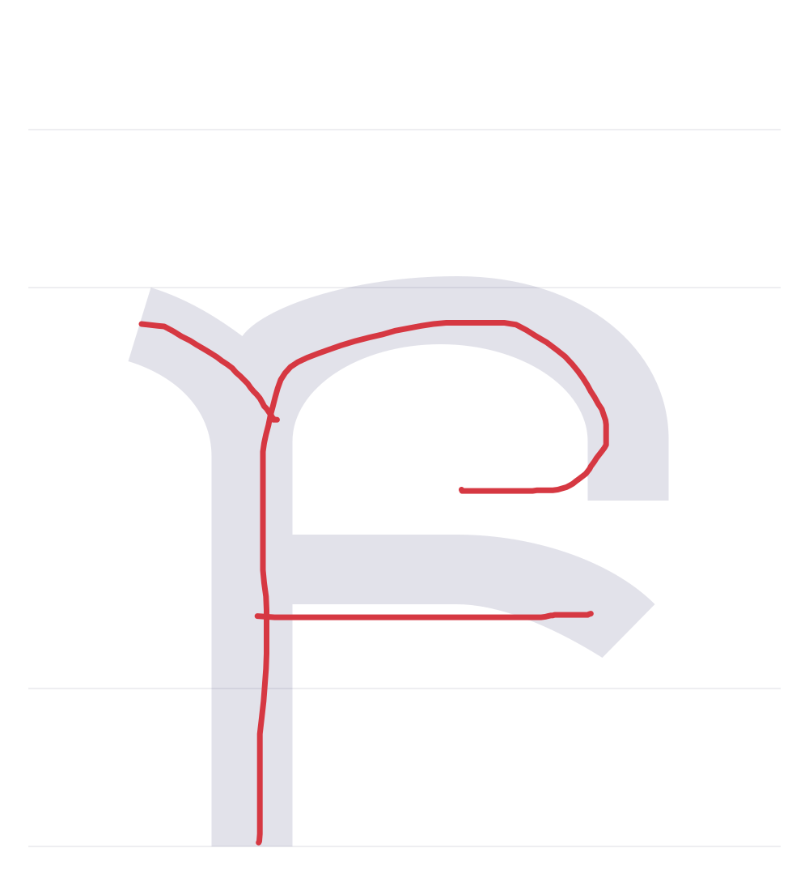](submissions/93a09cc1-2cf1-49d1-853c-4845d388fa7f/U0562-ba9291197244a956c76b8435be0b4dd2.svg)

[SVG](submissions/93a09cc1-2cf1-49d1-853c-4845d388fa7f/U0562-ba9291197244a956c76b8435be0b4dd2.svg) · [Данные](submissions/93a09cc1-2cf1-49d1-853c-4845d388fa7f/U0562-ba9291197244a956c76b8435be0b4dd2.json)

### Բ · 2026-11-01 07:55 UTC

[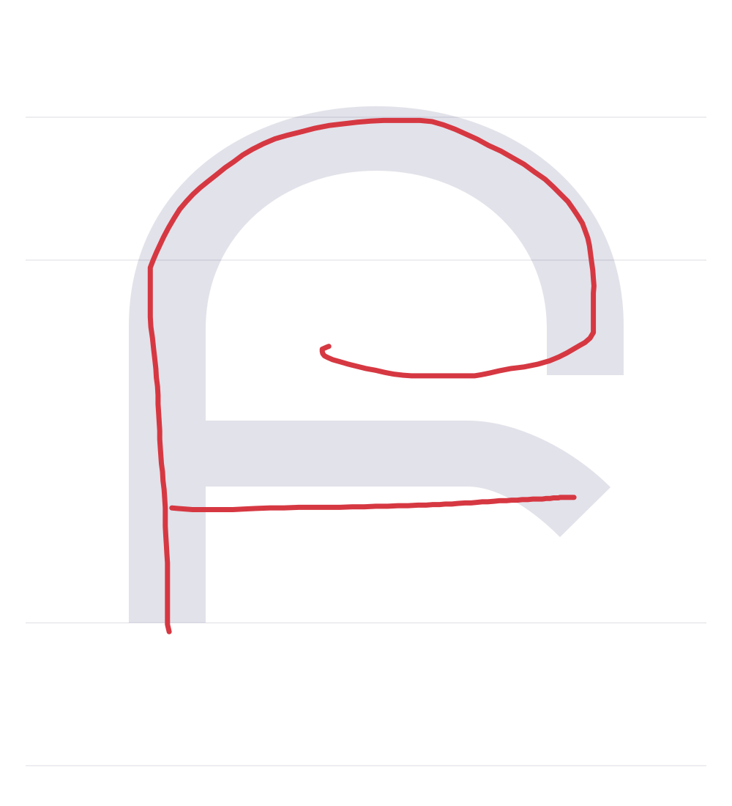](submissions/93a09cc1-2cf1-49d1-853c-4845d388fa7f/U0532-35b34e4e5000396c6c13e148003860c0.svg)

[SVG](submissions/93a09cc1-2cf1-49d1-853c-4845d388fa7f/U0532-35b34e4e5000396c6c13e148003860c0.svg) · [Данные](submissions/93a09cc1-2cf1-49d1-853c-4845d388fa7f/U0532-35b34e4e5000396c6c13e148003860c0.json)

### բ · 2026-11-01 07:46 UTC

[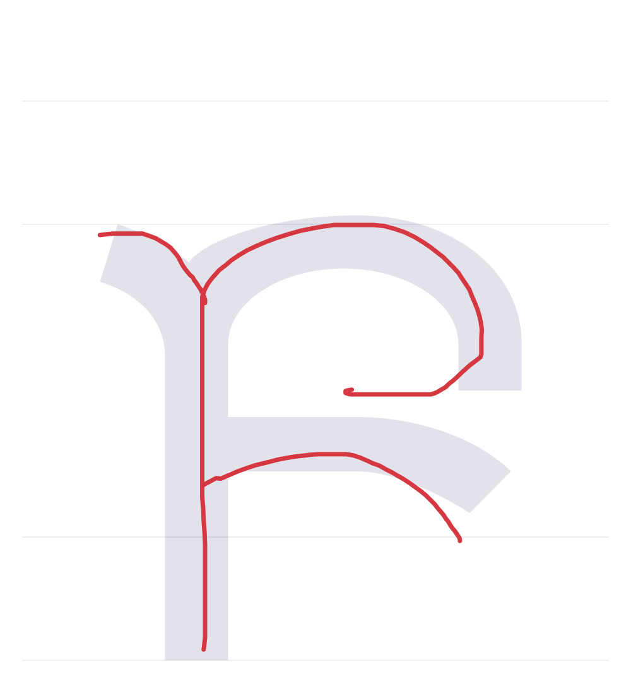](submissions/65eb7f05-60bd-4f7e-a76d-c6f046790e57/U0562-8a5217657e1de58a29db6622528ad796.svg)

[SVG](submissions/65eb7f05-60bd-4f7e-a76d-c6f046790e57/U0562-8a5217657e1de58a29db6622528ad796.svg) · [Данные](submissions/65eb7f05-60bd-4f7e-a76d-c6f046790e57/U0562-8a5217657e1de58a29db6622528ad796.json)

### Բ · 2026-11-01 07:44 UTC

[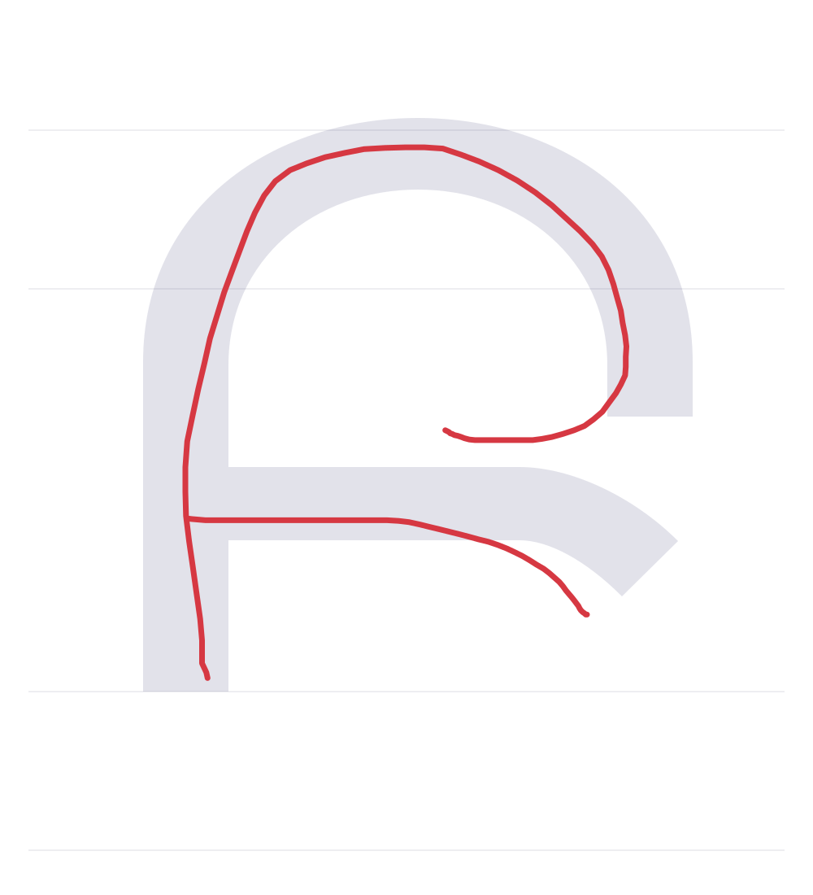](submissions/65eb7f05-60bd-4f7e-a76d-c6f046790e57/U0532-33da1b2890e39d0a28a5d0de99bdd65d.svg)

[SVG](submissions/65eb7f05-60bd-4f7e-a76d-c6f046790e57/U0532-33da1b2890e39d0a28a5d0de99bdd65d.svg) · [Данные](submissions/65eb7f05-60bd-4f7e-a76d-c6f046790e57/U0532-33da1b2890e39d0a28a5d0de99bdd65d.json)

### բ · 2026-11-01 07:35 UTC

[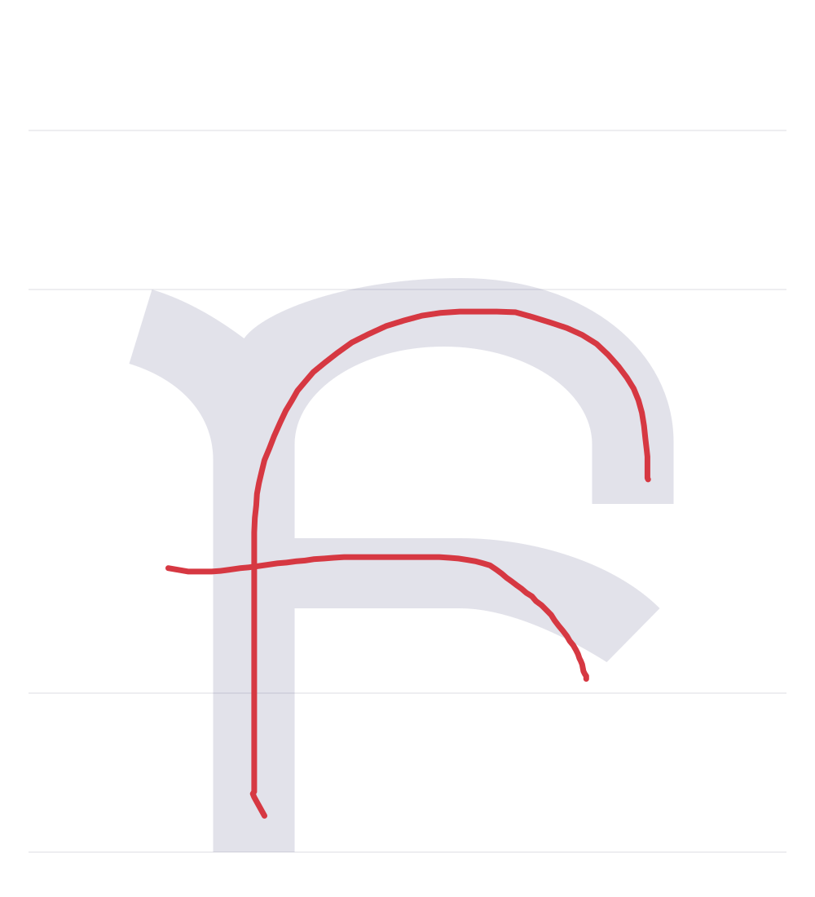](submissions/115cf32f-3ebe-476b-bc89-f7a3ff1a6145/U0562-c8794eb041f2468fcff0ca601e24a71e.svg)

[SVG](submissions/115cf32f-3ebe-476b-bc89-f7a3ff1a6145/U0562-c8794eb041f2468fcff0ca601e24a71e.svg) · [Данные](submissions/115cf32f-3ebe-476b-bc89-f7a3ff1a6145/U0562-c8794eb041f2468fcff0ca601e24a71e.json)

### Բ · 2026-11-01 07:34 UTC

[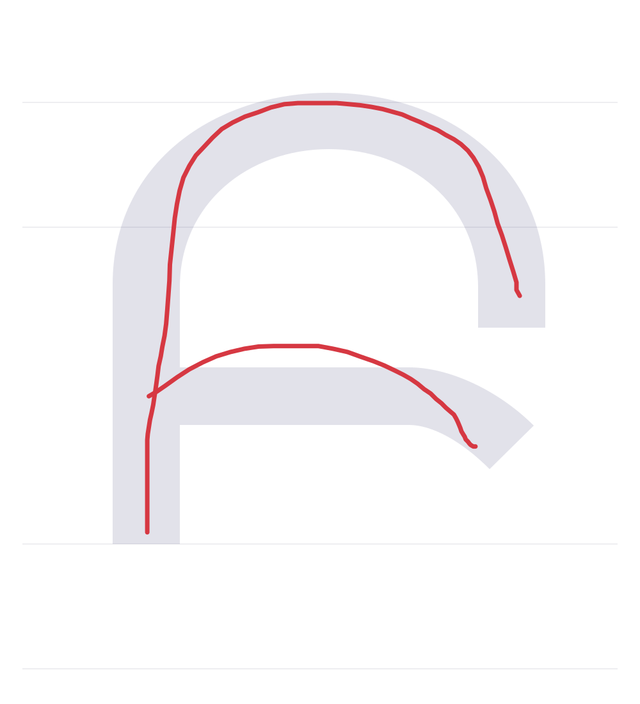](submissions/115cf32f-3ebe-476b-bc89-f7a3ff1a6145/U0532-17ae425133686ffc74c8e30fb21ba2de.svg)

[SVG](submissions/115cf32f-3ebe-476b-bc89-f7a3ff1a6145/U0532-17ae425133686ffc74c8e30fb21ba2de.svg) · [Данные](submissions/115cf32f-3ebe-476b-bc89-f7a3ff1a6145/U0532-17ae425133686ffc74c8e30fb21ba2de.json)

### ա · 2026-11-01 07:34 UTC

[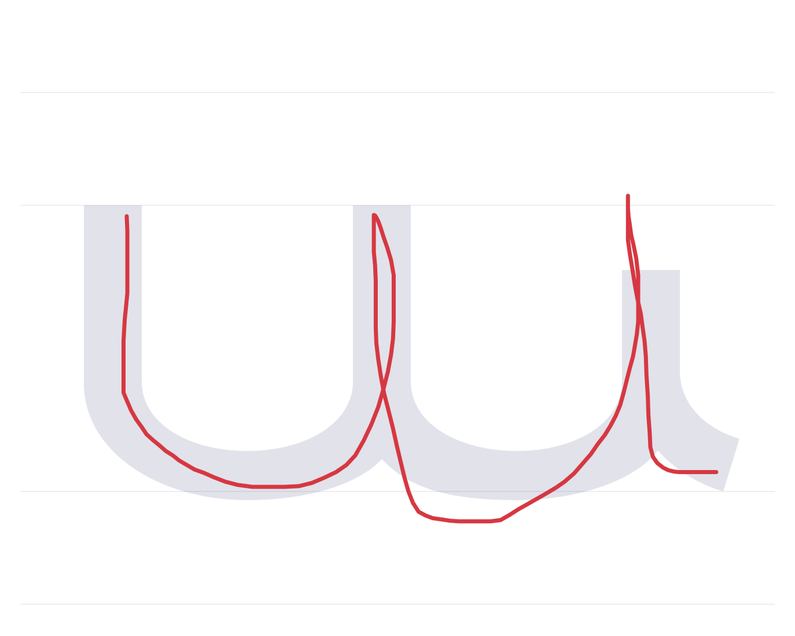](submissions/115cf32f-3ebe-476b-bc89-f7a3ff1a6145/U0561-f048eb802faf5d0fdf20bfa8304508ea.svg)

[SVG](submissions/115cf32f-3ebe-476b-bc89-f7a3ff1a6145/U0561-f048eb802faf5d0fdf20bfa8304508ea.svg) · [Данные](submissions/115cf32f-3ebe-476b-bc89-f7a3ff1a6145/U0561-f048eb802faf5d0fdf20bfa8304508ea.json)

### Ա · 2026-11-01 07:34 UTC

[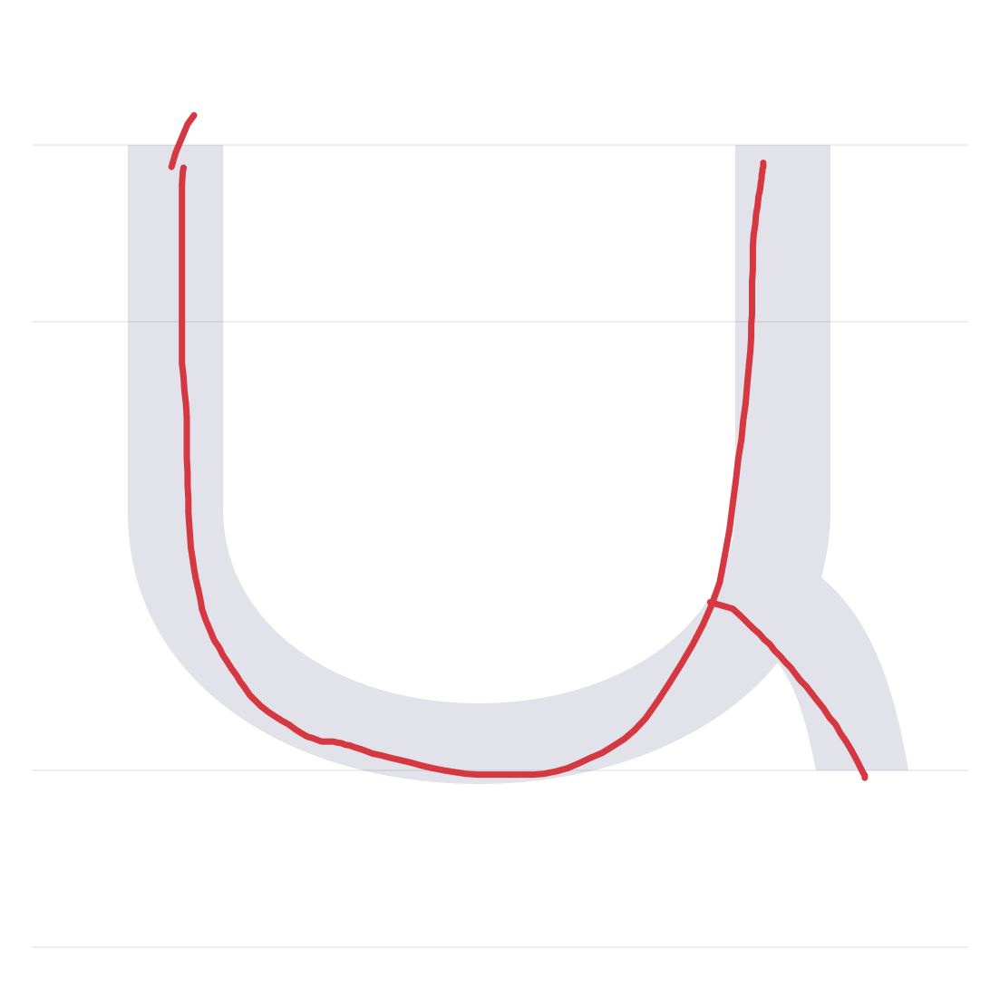](submissions/115cf32f-3ebe-476b-bc89-f7a3ff1a6145/U0531-ad649cc51860d6a8fbcaef0681cb8dff.svg)

[SVG](submissions/115cf32f-3ebe-476b-bc89-f7a3ff1a6145/U0531-ad649cc51860d6a8fbcaef0681cb8dff.svg) · [Данные](submissions/115cf32f-3ebe-476b-bc89-f7a3ff1a6145/U0531-ad649cc51860d6a8fbcaef0681cb8dff.json)
